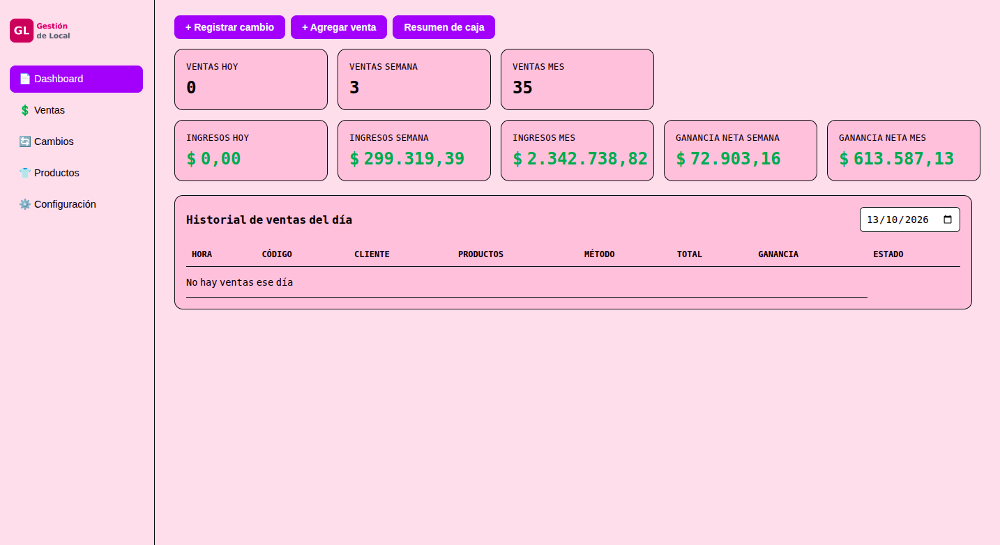
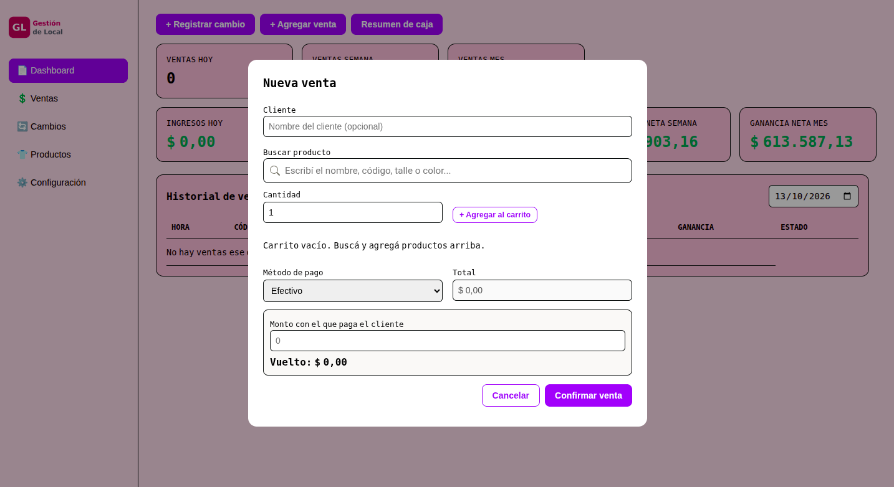
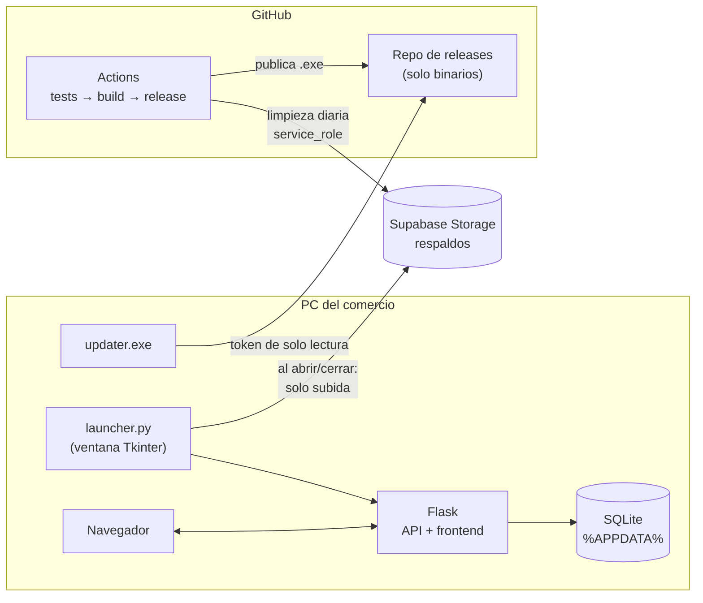

# Gestión de Local 

[](https://github.com/bluporini/gestion-de-local/actions/workflows/tests.yml)

Sistema de gestión desarrollado para **Alba Ropa Íntima**, un comercio de indumentaria que lo usa en su día a día: **stock por variantes, ventas, cambios y devoluciones, caja diaria y respaldos automáticos en la nube**. Es una aplicación de escritorio que se instala en Windows y se actualiza sola.

Este repositorio es la versión pública para portfolio (publicada con autorización del cliente). La demo usa **datos ficticios**, no información real del comercio.

**[▶ Probar la demo online](https://gestiondelocal-bluporini.onrender.com)** · datos de ejemplo, podés usarla libremente (la primera carga puede tardar unos segundos si el servidor estaba dormido).




---

## Qué hace

- **Productos con variantes** (talle, color, pack), cada una con su stock, costo, precio y margen. Códigos generados automáticamente.
- **Ventas** con carrito, efectivo (calcula el vuelto) o tarjeta, códigos de venta por día y **canal de venta** (en el local o virtual).
- **Cambios y devoluciones parciales**: devolver una prenda y llevarse otra, con la diferencia de dinero y el impacto en stock y ganancia. Editables y reversibles.
- **Dashboard y caja diaria**: ingresos y ganancia del día, semana y mes, stock bajo (con umbral configurable), un resumen de caja listo para enviar por WhatsApp o exportar a PDF, y el monto vendido en los últimos 3 meses.
- **Estadísticas de 12 meses**: ingresos, ganancia, cantidad de ventas y ventas por canal, con gráficos hechos en HTML/CSS para que funcionen sin internet.
- **Envíos**: seguimiento por estado (por preparar, despachado, entregado, con problema, resuelto), que se pueden vincular a la venta.
- **Notas**: una lista de pendientes con etiquetas, y observaciones en cada producto, venta y cambio.
- **Exportar a Excel** (CSV) las ventas de un período y el stock.
- **Respaldos automáticos** en Supabase al abrir y cerrar la app, y **restauración** desde un archivo de respaldo.
- **Actualizaciones automáticas**: avisa cuando hay versión nueva y se actualiza al reabrirla.

## Requerimientos del cliente

Los requerimientos se definieron en reuniones con el cliente a lo largo del desarrollo. Además de lo central, la **gestión de stock y de ventas**, surgieron necesidades propias de cómo trabaja el local:

- **Identidad visual:** una interfaz con **fondo rosa**, acorde a la imagen del comercio.
- **Resumen de caja para WhatsApp:** al cierre del día, la app arma un **texto con las ventas, los cambios y los totales por medio de pago**, listo para copiar y pegar en WhatsApp con un clic (también se puede exportar a PDF).
- **Ventas en el local y virtuales:** cada venta registra su canal, y las estadísticas muestran mes a mes cuántas ventas hubo en cada uno.

## Stack

| Capa | Tecnología |
|---|---|
| Backend | Python, Flask, SQLite (sin ORM) |
| Frontend | HTML, CSS y JavaScript puro (ES modules, sin build) |
| Escritorio | Tkinter (ventana de control) + PyInstaller (ejecutable único) |
| Instalador | Inno Setup (Windows), `.deb` (Linux) |
| Nube | Supabase Storage (respaldos), GitHub Releases (actualizaciones) |
| CI/CD | GitHub Actions: tests, build del `.exe` e instalador, publicación de releases |
| Tests | pytest |

## Arquitectura



La app corre localmente: `launcher.py` levanta Flask en un hilo y el navegador se conecta a `127.0.0.1`. Funciona sin internet; los respaldos y las actualizaciones se hacen cuando hay conexión.

## Correr localmente

```bash
python3 -m venv venv && source venv/bin/activate
pip install -r backend/requirements-dev.txt

python test/generar_db.py      # base de ejemplo (~2 años de ventas)
python backend/wsgi.py         # abre http://127.0.0.1:5000

python -m pytest -q            # tests
```

## Demo online

La demo web usa el mismo código, servido con gunicorn (`backend/demo.py`): genera la base de ejemplo con fecha de hoy al arrancar, muestra un cartel de demo y deshabilita los respaldos y la restauración. Se despliega en Render con `render.yaml` (plan gratuito). El disco es efímero, así que los datos se reinician solos cuando el servidor se reinicia.

## Estructura

```text
backend/app/        API Flask (un blueprint por área), base de datos y respaldos
backend/tests/      Tests (pytest) sobre una SQLite temporal
backend/demo.py     Punto de entrada de la demo web
frontend/           Interfaz (HTML/CSS/JS sin build)
installer/          Instalador de Windows, .deb y updater
scripts/            Limpieza de respaldos (GitHub Actions)
launcher.py         Punto de entrada del ejecutable
schema.sql          Esquema + triggers
docs/               Instalación, desarrollo, actualizaciones y respaldos
```

## Cómo se desarrolló

Diseñé y desarrollé el backend del sistema, incluyendo el modelo de datos, la lógica de ventas, cambios y devoluciones, la gestión de caja y las operaciones de stock.

Para el frontend, trabajé con Claude Code como asistente de programación, utilizándolo para implementar la interfaz y realizar ajustes durante el desarrollo. También lo utilicé en la etapa final para reforzar el sistema de actualizaciones, los respaldos en Supabase, los tests automatizados y la integración continua (CI).

Las decisiones de arquitectura, la integración de los componentes y la revisión de los cambios quedaron a mi cargo.

---

Desarrollado por **Brian Luporini**
